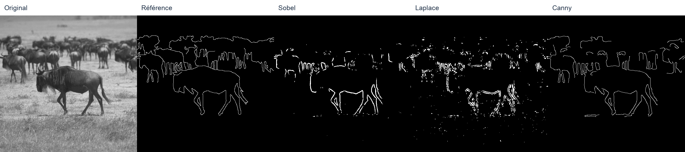

# OpenCV - Homework 3 : détection de contours

**Omar Benjelloun - Polytech Marseille**

Comparaison de **Sobel, Laplace et Canny** en C++17 avec OpenCV : réglages par curseurs, traitement par lot et évaluation par rapport à des contours annotés à la main.

Ce dépôt contient uniquement le Homework 3. Le dossier de remise est [`TP_contours/`](TP_contours/).

- [Rapport PDF](TP_contours/report/rapport.pdf)
- [Code source](TP_contours/src/)
- [Mesures complètes au format CSV](TP_contours/results/all_metrics.csv)
- [Instructions détaillées](TP_contours/README.md)
- [Vérifications](TP_contours/VALIDATION.md)

## Démarrage rapide

Prérequis : C++17, CMake et OpenCV (`brew install cmake opencv` sur Mac, ou `sudo apt install build-essential cmake libopencv-dev` sur Debian/Ubuntu).

```bash
cd TP_contours
bash build.sh
./build/contours --gui --detector canny --sigma 2 --low 40 --high 120
```

Les 40 images et leurs références sont incluses. La touche `b` traite le lot courant ; les fichiers produits sont enregistrés dans `results/manual/`.

## Résultats

Paramètres sélectionnés sur 10 images puis évalués sur 30 autres ; comparaison avec une tolérance d'un pixel (voisinage 3 × 3).

| Détecteur | Performance P | TFP | TFN |
|---|---:|---:|---:|
| Sobel | 0,178 | 0,258 | 0,564 |
| Laplace | 0,112 | 0,368 | 0,520 |
| Canny | 0,257 | 0,133 | 0,610 |

Canny obtient le meilleur P moyen avec cette tolérance. En comparaison exacte, Sobel passe légèrement devant Canny. Les résultats dépendent du protocole et des paramètres.



La vidéo explicative est transmise séparément dans le courriel de remise.

## Source des images

[Base de contours de Groningen](https://www.cs.rug.nl/~imaging/databases/contour_database/contour_database.html), utilisée dans le sujet du TP. Les images et annotations restent attribuées à leurs auteurs ; leur provenance et leurs empreintes sont conservées dans [`provenance.json`](TP_contours/data/provenance.json).

C. Grigorescu, N. Petkov et M. A. Westenberg, *Contour detection based on non-classical receptive field inhibition*, IEEE Transactions on Image Processing, 12(7), 729-739, 2003.
